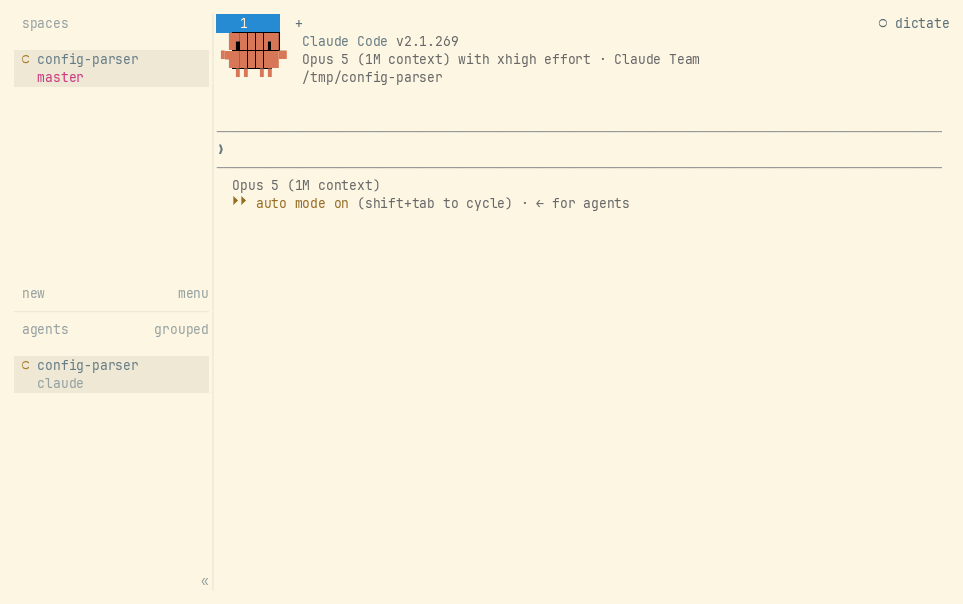

<div align="center">

# herdr-dictate

**Speak into any pane.** Local speech-to-text for [Herdr](https://herdr.dev): press a key, talk, and
the transcript is typed where you were looking.

[](https://github.com/abhishekrana/herdr-dictate/actions/workflows/ci.yml)
[](https://github.com/abhishekrana/herdr-dictate/releases)
[](LICENSE)


[Install](#install) · [Usage](#usage) · [Configuration](#configuration) ·
[Troubleshooting](#troubleshooting)

</div>



Audio never leaves the machine. [transcribe.cpp](https://github.com/handy-computer/transcribe.cpp) is
compiled in, the model is downloaded and verified by the plugin, and the model server is this same
binary - there is no sidecar to install and nothing to run yourself. A GPU is used automatically when
one is present, and the CPU otherwise. The default model is Parakeet; Whisper models remain a setting
away.

## Install

```sh
herdr plugin install abhishekrana/herdr-dictate
herdr plugin pane open --plugin abhishekrana.dictate --entrypoint setup
```

Herdr plugins cannot register their own keys, so `setup` offers to add them: `prefix+v` dictates,
`prefix+shift+v` dictates and submits. It backs up `config.toml` and appends rather than rewriting,
so comments survive.

Installing downloads a prebuilt binary when one fits this machine, and compiles otherwise.

### Requirements for compiling

`scripts/install-deps.sh` installs these on Debian and Ubuntu.

| what | Debian and Ubuntu package | for |
| ---- | ------------------------- | --- |
| Rust 1.88 or newer | [rustup](https://rustup.rs) | everything |
| a C and C++ compiler, CMake, pkg-config | `build-essential`, `cmake`, `pkg-config` | transcribe.cpp |
| ALSA headers | `libasound2-dev` | the microphone |
| Vulkan headers and loader, `glslc` | `libvulkan-dev`, `glslc` | the GPU build |
| SPIRV-Headers | `spirv-headers` | the GPU build |
| OpenBLAS, optional | `libopenblas-dev` | the CPU decoder; linked when present |

Without the three GPU rows the build runs on the CPU only. OpenBLAS made no measurable difference to
dictation-length clips, on the GPU or the CPU, so the script leaves it out; install it yourself to
try it.

## Usage

Press the key, speak, then press it again. Or just stop talking - a couple of seconds of silence
ends the recording on its own. The first dictation downloads the model, so it takes noticeably
longer than every one after it.

| action        | what it does                                       |
| ------------- | -------------------------------------------------- |
| `toggle`      | start recording, or stop and insert the transcript  |
| `toggle-send` | the same, then press Enter once the transcript lands |
| `doctor`      | check every dependency and say what to do about it  |

Any desktop shortcut can start a dictation, whether or not Herdr has focus - bind this command:

```sh
herdr plugin action invoke abhishekrana.dictate.toggle-send
```

On GNOME that is Settings → Keyboard → Custom Shortcuts. A single key works, a bare modifier
included. Name `herdr` by its full path: a shortcut does not run with a login shell's `PATH`.

### Status chip

`status` prints one chip for Herdr's tab bar, so the state shows in every workspace - `○` idle, `●`
recording, `◌` while the model runs. `doctor` prints the line to paste:

```toml
# ~/.config/herdr/config.toml, under [ui]
tab_bar_right = [
  { type = "command", command = "/path/to/herdr-dictate status", interval_seconds = 1 },
]
```

## Configuration

Optional, at `config.toml` in `herdr plugin config-dir abhishekrana.dictate`:

```toml
[engine.model]
name = "parakeet-ultra"      # or a Whisper model: tiny.en, base.en, base.en-q8_0, small.en-q8_0, small.en

[[engine.replace]]           # a word the model keeps getting wrong
from = "work tree"
to = "worktree"

[silence]
threshold = 300.0            # how loud audio must be to count as speech
trailing_secs = 2.0          # seconds of silence that end a recording; 0 to never stop on its own
```

Models download on first use and are checked against a known hash. The default, `parakeet-ultra`,
is 706 MB: [Moondream's post-trained Parakeet](https://huggingface.co/moondream/parakeet-ultra)
(CC-BY-4.0), in [the Q8_0 GGUF build](https://huggingface.co/handy-computer/parakeet-ultra-gguf).
Its wait after you stop talking grows with what you said: on an integrated GPU a short command came
back in about 0.2 s and a sentence in 0.4 s, where `small.en-q8_0` took about a second either way. On
silence and noise it writes nothing.

Parakeet takes no prompt, so a term it hears wrong is fixed with a replacement instead. Each
`[[engine.replace]]` entry rewrites `from` to `to` wherever `from` is a whole word or phrase. A
lowercase `from` matches any casing; one with a capital matches only as written, so `Herder` leaves
the ordinary word alone. A match at a sentence start keeps its capital. Add an entry when a term
comes out wrong, with `from` spelt the way the model wrote it.

The Whisper models take a `prompt` that biases their vocabulary. `small.en-q8_0` is 252 MB; `tiny.en`
is 74 MB and noticeably worse. A `q8_0` model is a compressed build of the same size class - half the
download, faster, and no accuracy difference observed.

<details>
<summary>Every setting, with defaults</summary>

```toml
[engine]
language = "en"
threads = 0                  # CPU threads; 0 lets transcribe.cpp choose, at most 8
prompt = "Terms: worktree, kubectl, herdr."   # Whisper models only; biases the vocabulary
replace = []                 # [[engine.replace]] entries, as above

[engine.model]
name = "parakeet-ultra"
# path = "/models/parakeet-tdt-0.6b-v3-Q8_0.gguf"   # a local file, used as-is
# url = "https://.../model.gguf"                    # any GGUF or ggml model transcribe.cpp runs
# sha256 = "..."                                    # required with url

[silence]
threshold = 300.0
trailing_secs = 2.0
max_secs = 120.0            # a recording never runs longer than this
min_speech_secs = 0.2       # unbroken loudness that counts as speech; a key click is shorter

[server]
enabled = true
idle_secs = 300              # 0 keeps the model resident forever

[status]                     # what the tab bar chip reads, printed verbatim
idle = "○ dictate"
recording = "● dictate"
transcribing = "◌ dictate"

[remote]                     # dictating to the machine selected in Herdr's sidebar
enabled = true
control_persist_secs = 300   # how long a shared ssh connection outlives its last use; 0 to reconnect every time

[remote.machines."<id or label from herdr machine list>"]
herdr = "/abs/path/to/herdr" # only when that machine keeps herdr somewhere discovery misses
```

`name`, `path` and `url` are alternatives; set exactly one.

</details>

## Troubleshooting

```sh
herdr plugin action invoke abhishekrana.dictate.doctor
herdr plugin log list --plugin abhishekrana.dictate
```

`doctor` names each dependency, what it found and what to do about it. It listens briefly to
compare the room against the speech threshold: if it reports a room louder than `threshold`, the
recording never hears silence, so it will not stop on its own until you raise that number.

Each dictation logs a `recorded` line: its length, what stopped it, and its loudest moment against `threshold`. A
`no speech` that follows a loudness well under `threshold` is a quiet or wrong microphone. One well over it is sound
the model heard as no words; with a Whisper model, `whisper heard no words` shows what it made of it. The model server logs to
`server.log` in the plugin's state directory, emptied each time a server starts. `HERDR_DICTATE_LOG=debug` increases
logging.

**Linux only** - the audio capture path does not handle macOS sample rates yet.

## Saved machines

Select a machine in Herdr's sidebar and a dictation goes to the pane you are looking at there. The microphone, the
model and the GPU stay on this machine; only the transcript crosses.

This plugin runs only on the machine you are sitting at - it is never installed on the far end, and does not need to
be. It needs an `ssh` client and non-interactive key authentication to that host: `ssh -o BatchMode=yes <host> true`
must succeed without a prompt, and a passphrased key needs `ssh-add`. Herdr puts its own binary on the host when you
add the machine, and that is the only thing required there. `doctor` reports all of it.

While a dictation runs, that pane's label says so, and `remote.json` in the host's plugin state directory
(`~/.local/state/herdr/plugins/abhishekrana.dictate/`) holds its phase and an expiry in the host's clock, for anything
there - a status line - to show:

```json
{ "phase": "recording", "until": 1790176000 }
```

It is refreshed well inside that expiry and removed when the dictation ends, so a file past `until` is a dictation
that lost its connection.

A pane whose agent has exited is back at a shell prompt, so a transcript is typed there but never submitted. Turn the
whole thing off with:

```toml
[remote]
enabled = false
```

## License

MIT - see [LICENSE](LICENSE).
